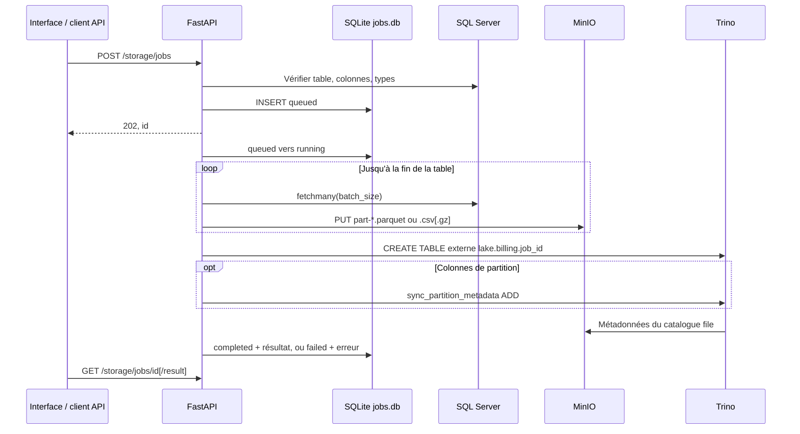

# Flux de données et contrats

**État : 26 novembre 2026.** Lire avec [l'architecture système](system.md). Les contrats exacts sont définis par [`backend/app/models.py`](../../backend/app/models.py) et les routes API.

## De la source au job

1. `GET /sources` lit les sources initiales de `SQL_SOURCES` et les sources ajoutées dans SQLite. `GET /sources/{id}/tables` interroge `sys.tables` et `sys.schemas` dans SQL Server. La route des colonnes lit `sys.columns`.
2. `POST /storage/jobs` accepte une table, `format` (`parquet` ou `csv`), `compression`, `batch_size` (1 à 250 000) et jusqu'à quatre noms de colonnes dans `partition_by`. La route valide l'existence et le type des colonnes ; le schéma source par défaut est `dbo`.
3. Le job est inséré dans SQLite en état `queued`. Le thread de [`backend/app/main.py`](../../backend/app/main.py) prend le plus ancien job, le marque `running`, appelle `ingest()`, puis écrit `completed` et les métriques ou `failed` et l'erreur.



## Organisation et conversion

Chaque extraction produit un snapshot indépendant :

```text
s3://warehouse/data/<source>/<schema>/<table>/<job_id>/
  [<colonne_partition>=<jour>/]
  part-00000000.parquet
```

Le préfixe est propre au job ; la table SQL cible est `lake.billing.job_<job_id>`. Les valeurs de `source`, `schema` et `table` sont encodées pour le chemin objet. Le résultat expose `storage_uri`, `sql_table`, `rows`, `files`, `bytes`, `extraction_seconds`, `load_seconds`, `catalog_seconds` et `total_seconds`.

Le worker appelle `fetchmany(batch_size)` et regroupe uniquement les lignes du lot courant par partition. Il convertit en Arrow puis écrit Parquet, ou écrit CSV ; la mémoire dépend donc du lot courant et des données sérialisées. Pour une colonne `DATE`, la valeur est utilisée directement dans le dossier ; pour `DATETIME`, `DATETIME2` ou `SMALLDATETIME`, une partition `<colonne>_day` est dérivée, et l'horodatage original reste dans les fichiers. Sans partition, les objets sont écrits directement sous le préfixe du job. Les noms exposés à Hive sont normalisés en minuscules.

Parquet conserve les types pris en charge par la conversion SQL Server → Arrow → Trino. Les colonnes CSV sont déclarées `VARCHAR` dans Trino. Les compressions acceptées sont `none`, `snappy`, `gzip`, `zstd` pour Parquet et `none`, `gzip` pour CSV ; la compression par défaut est `snappy` pour Parquet et aucune pour CSV. Un tri SQL sur les colonnes de partition précède `fetchmany` lorsqu'un partitionnement est demandé ; il peut augmenter le coût d'extraction.

## Catalogue et lecture SQL

Après l'envoi des fichiers, `ingest()` exécute `CREATE TABLE ... WITH (format, external_location, partitioned_by)` dans Trino. En présence de partitions et de fichiers, il appelle `lake.system.sync_partition_metadata`. Le catalogue `lake` est le connecteur Hive avec métastore `file` persisté dans MinIO. Une erreur de DDL ou de synchronisation marque le job en échec ; la table est supprimée, mais les fichiers déjà envoyés ne le sont pas.

L'interface utilise `POST /sql/query` pour envoyer une requête à Trino. Cette route accepte une seule instruction dont le premier mot clé est `SELECT`, `WITH`, `SHOW`, `DESCRIBE`, `EXPLAIN` ou `VALUES`, refuse un point-virgule interne et affiche au plus 200 lignes dans l'UI (limite API : 1 000). `GET /analysis/{job_id}` fournit l'aperçu de 100 lignes ou un `count`, éventuellement filtré sur une partition quotidienne. Ces validations sont applicatives et ne remplacent pas une politique de droits Trino.

## Jeu de données et benchmark

[`data/seed.sql`](../../data/seed.sql) crée `dbo.Customer`, `dbo.Invoice`, `dbo.Payment` dans `Billing` au premier démarrage. Avec `DEMO_INVOICES=1000000`, il génère 100 000 clients, 1 000 000 de factures et environ 750 000 paiements. Le script [`backend/app/services/benchmark.py`](../../backend/app/services/benchmark.py) produit 16 scénarios : deux formats × partitionnement oui/non × compression Gzip/aucune × deux tailles de lots. Les mesures sont dans [`data/results/`](../../data/results/) et présentées par `/performance/results`. Les résultats versionnés correspondent à une campagne locale ponctuelle ; ils ne sont pas régénérés automatiquement au démarrage.
