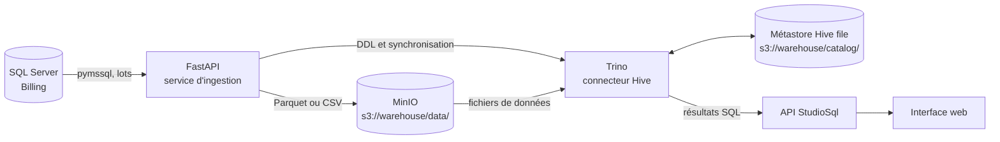
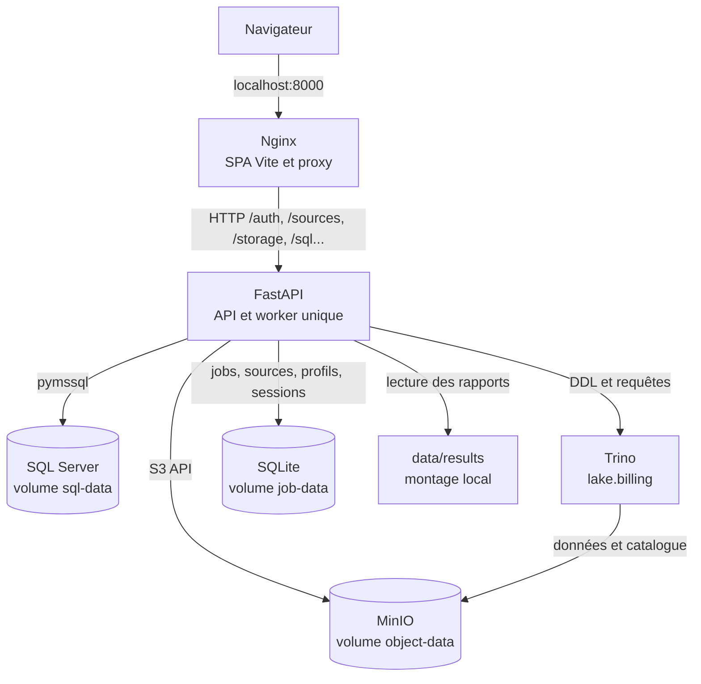

# Architecture système

**État : 26 novembre 2026.** Cette vue décrit l'implémentation actuelle, pas une architecture cible future. Voir aussi [le flux d'extraction](data-flow.md) et le [contexte court](../../CONTEXT.md).

## Chaîne analytique

Le catalogue est une **fonction du connecteur Hive de Trino** configurée dans [`docker/trino/catalog/lake.properties`](../../docker/trino/catalog/lake.properties). Trino persiste ses métadonnées dans MinIO. Le dossier `docker/hive-metastore/` documente ce choix ; aucun service Hive Metastore n'est lancé par Compose. Le dépôt d'objets seul ne rend pas une table interrogeable : le worker crée une table externe, puis synchronise ses partitions éventuelles.

## Déploiement local

| Service Compose | Responsabilité | Accès depuis l'hôte |
| --- | --- | --- |
| `frontend` | Nginx sert le bundle Vite et relaie l'API | `127.0.0.1:8000` |
| `api` | FastAPI, authentification, exploration, extraction, SQL, benchmark | `127.0.0.1:8002` |
| `sqlserver` | Base source `Billing`, tables `dbo.Customer`, `dbo.Invoice`, `dbo.Payment` | aucun port publié |
| `minio` | Objets S3 compatibles, données et métadonnées | console `127.0.0.1:9001` |
| `trino` | Catalogue `lake`, schéma `billing`, SQL analytique | `127.0.0.1:8080` |

Le code d'API est dans [`backend/app/`](../../backend/app/), les routes dans [`backend/app/routers/`](../../backend/app/routers/) et le flux de traitement dans [`backend/app/services/ingestion.py`](../../backend/app/services/ingestion.py). L'interface est une SPA HTML/CSS/JavaScript dans [`frontend/`](../../frontend/) ; la navigation utilise des fragments d'URL (`#sources`, `#workspace`, `#jobs`, `#sql`, `#history`, `#profile`). En développement Vite, [`frontend/vite.config.ts`](../../frontend/vite.config.ts) relaie également les routes API vers `localhost:8002`.

## Frontières de persistance et de sécurité

- `sql-data` conserve la base source fictive ; `object-data` conserve les exports et le catalogue ; `job-data` conserve `jobs.db`. `data/results/` est un montage du dépôt, pas un volume Docker nommé.
- Le navigateur ne se connecte pas directement à SQL Server ni à MinIO pour les extractions. FastAPI orchestre ces accès. Le navigateur utilise l'API via Nginx et reçoit des résultats SQL limités.
- L'authentification StudioSql protège l'API, y compris `/docs` et `/openapi.json`. Seul `GET /health` reste public. Les fichiers statiques de l'interface sont publics mais ne contiennent pas les données SQL.
- Le cookie de session est `HttpOnly`, `SameSite=Strict`, valable 12 heures. Les requêtes d'écriture exigent le jeton CSRF de la session. Les sessions sont effacées au redémarrage de l'API ; le profil affiché persiste.
- Trino et la console MinIO sont publiés uniquement sur la boucle locale et ne partagent pas l'authentification de l'API. Les identifiants de démonstration des services sont définis dans Compose et dans le catalogue Trino : ce montage est destiné au poste local.

## Reprise après incident

Au démarrage, un job resté `running` est marqué `failed` avec l'erreur « Service interrompu ». Les jobs `queued` restent en base et le worker les reprend. En cas d'échec pendant l'enregistrement dans Trino, la table externe partiellement créée est supprimée ; les objets déjà envoyés à MinIO peuvent néanmoins rester. Une relance automatique et un nettoyage des objets orphelins ne sont pas implémentés.
